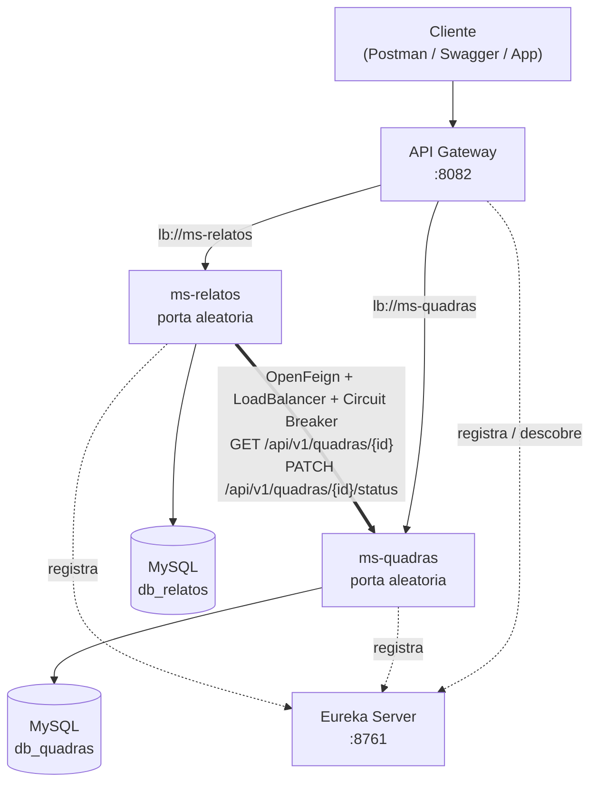

# Alaga Não

Sistema de alerta de alagamento **por quadra** (rua a rua), construído em arquitetura de microsserviços.
Global Solution FIAP — *Microservice and Web Engineering & IT Services*.

O **Alaga Não** calcula uma nota de risco para cada quadra e cruza esse risco com relatos enviados pelos próprios
moradores. Quando vários relatos chegam da mesma quadra em poucos minutos, o sistema marca aquela quadra como
**ALAGADO** automaticamente, sem ninguém precisar confirmar nada manualmente.

---

## Integrantes

| Nome | RM |
|---|---|
| Bruno Hideki Itikawa | RM554924 |
| Gabriel Shoiti Yoshida | RM558945 |
| Matheus Keizo Shimomoto Hangui | RM557834 |

---

## O problema

Os alertas de chuva hoje são **genéricos por região**: "pancadas de chuva na Zona Oeste", "risco de alagamento na
capital". Isso não ajuda quem precisa decidir se sai de casa, por onde desviar ou se dá tempo de tirar o carro da
garagem. A informação existe no nível da cidade, mas **ninguém sabe se a SUA rua vai alagar**, e quem sabe são
justamente os moradores que estão vendo a água subir, sem nenhum canal para avisar os outros.

## A solução

Um sistema que trabalha na menor unidade possível: a **quadra**.

1. Cada quadra tem uma **nota de risco** (0 a 100) que gera um **nível de risco**: `BAIXO` (0–39), `MEDIO` (40–69)
   ou `ALTO` (70–100).
2. Qualquer morador pode enviar um **relato** ("está alagando aqui"), com descrição e foto.
3. Quando a mesma quadra recebe **3 ou mais relatos em 15 minutos**, o sistema muda o status dela para
   **`ALAGADO`** e marca aqueles relatos como `CONFIRMADO`.

O resultado é um mapa de alagamento alimentado por quem está na rua, no nível do quarteirão.

---

## Arquitetura



### Como o status da quadra muda (comunicação síncrona)

Ao receber um `POST /api/v1/relatos`, o **ms-relatos** primeiro consulta a quadra no **ms-quadras** via **OpenFeign**
(resolvendo o endereço pelo **Eureka**, sem URL fixa). Se a quadra não existir, a requisição é recusada com 404.
Salvo o relato como `PENDENTE`, o serviço conta quantos relatos aquela quadra recebeu nos últimos 15 minutos; ao
atingir 3, ele chama de volta o ms-quadras com `PATCH /api/v1/quadras/{id}/status` enviando `{"status":"ALAGADO"}`.
Confirmada a atualização, os relatos pendentes daquela quadra passam a `CONFIRMADO`.
Se o ms-quadras estiver fora do ar, o **Circuit Breaker (Resilience4J)** desvia para a classe de *fallback*: o relato
continua sendo salvo como `PENDENTE` e a requisição não quebra, apenas o status da quadra não é alterado.

### Os 4 projetos

| Projeto | Porta | Papel |
|---|---|---|
| `eureka-server` | 8761 | Service Discovery, onde todos os outros se registram |
| `api-gateway` | 8082 | Porta de entrada única; roteia por nome de serviço (discovery locator) |
| `ms-quadras` | aleatória (`server.port=0`) | CRUD de quadras, cálculo do nível de risco e do status de alagamento |
| `ms-relatos` | aleatória (`server.port=0`) | CRUD de relatos e a regra dos 3 relatos em 15 minutos |

---

## Tecnologias e versões

| Tecnologia | Versão |
|---|---|
| Java | 25 |
| Spring Boot | 4.1.2 |
| Spring Cloud | 2025.1.4 |
| Spring Cloud Netflix Eureka (server/client) | 5.0.3 |
| Spring Cloud Gateway (server-webflux) | 5.0.x (Spring Cloud 2025.1.4) |
| Spring Cloud OpenFeign | 5.0.4 (feign-core 13.6.1) |
| Feign HTTP client | feign-hc5 (Apache HttpClient 5), necessário para o método `PATCH` |
| Spring Cloud LoadBalancer | 5.0.4 |
| Resilience4J (Circuit Breaker) | 2.3.0 |
| Spring Data JPA / Hibernate | Hibernate ORM 7.4.13.Final |
| Flyway (core + mysql) | 12.4.0 |
| MySQL | Servidor 8.4 (Docker) · driver `mysql-connector-j` 9.7.0 |
| Lombok | 1.18.48 |
| springdoc-openapi (Swagger UI) | 3.2.0 |
| Docker Compose | arquivo na raiz (`docker-compose.yml`) |
| Maven | não precisa instalar, cada projeto tem o Maven Wrapper (3.9.15) |

---

## Pré-requisitos

- **Java 25** (JDK).
- **Docker**. No Windows, o Docker Desktop precisa estar aberto antes do `docker compose`.
- **Git**.
- Maven não é necessário: use o `mvnw` / `mvnw.cmd` de cada projeto.
- Portas **8761** (Eureka), **8082** (Gateway) e **3306** (MySQL) livres.

---

## Como executar

Cada serviço roda no seu próprio terminal. Nos comandos abaixo, use `.\mvnw` no PowerShell e `./mvnw` no Linux/Mac.

### a) Clonar o repositório

```bash
git clone https://github.com/ItikawaBruno/GS-MICROSERVICE-AND-WEB-ENGINEERING---IT-SERVICES.git
cd GS-MICROSERVICE-AND-WEB-ENGINEERING---IT-SERVICES
```

### b) Subir o MySQL

Na raiz do repositório, onde está o `docker-compose.yml`:

```bash
docker compose up -d
docker compose ps
```

O `STATUS` precisa estar `healthy` antes de subir os microsserviços:

```
NAME               IMAGE        STATUS                   PORTS
alaga-nao-mysql    mysql:8.4    Up 40 seconds (healthy)  0.0.0.0:3306->3306/tcp
```

Se aparecer `(health: starting)`, aguarde alguns segundos e rode `docker compose ps` de novo.

Os bancos `db_quadras` e `db_relatos` não precisam ser criados à mão: cada microsserviço cria o seu na primeira
conexão (`createDatabaseIfNotExist=true`). Usuário `root`, senha `root`.

### c) Subir os serviços

Nesta ordem, um terminal para cada, aguardando o anterior iniciar:

```
eureka-server  →  api-gateway  →  ms-quadras  →  ms-relatos
```

```bash
cd eureka-server
./mvnw spring-boot:run
```

O Eureka sobe em **http://localhost:8761**, e é ali que os outros três aparecem como `UP` conforme iniciam. O painel
atualiza a cada ~30 segundos, então um serviço recém-iniciado pode levar meio minuto para aparecer.

Tabelas e carga inicial são automáticas: na primeira execução de cada microsserviço o **Flyway** aplica as migrations
de `src/main/resources/db/migration`, criando a tabela (`quadras` / `relatos`) e inserindo os dados iniciais, que são
5 quadras de São Paulo e 5 relatos. Nas execuções seguintes ele reconhece que já aplicou e não faz nada.

### d) Alternativa: rodar pelo IntelliJ

1. `File > Open` e abra cada uma das 4 pastas como projeto separado. O IntelliJ importa o Maven sozinho.
2. Em `File > Project Structure > Project SDK`, selecione o JDK 25 em cada projeto.
3. Rode as classes principais na ordem: `EurekaServerApplication`, `ApiGatewayApplication`, `MsQuadrasApplication`,
   `MsRelatosApplication`.
4. O MySQL do passo (b) precisa estar rodando antes dos microsserviços.

### e) Subir múltiplas instâncias (escalabilidade)

Como os microsserviços usam `server.port=0`, não há conflito de porta e nada precisa ser configurado. Basta abrir
outro terminal e rodar o mesmo comando:

```bash
cd ms-quadras
./mvnw spring-boot:run
```

O painel do Eureka passa a mostrar duas instâncias de `MS-QUADRAS`, com `instance-id` diferentes graças a
`${random.value}`, e o **Spring Cloud LoadBalancer** distribui entre elas tanto as chamadas vindas do Gateway quanto
as chamadas Feign do ms-relatos.

---

## Endpoints

Todas as rotas passam pelo **Gateway em `http://localhost:8082`**. O gateway usa o *discovery locator* do Spring Cloud
Gateway: o primeiro segmento da URL é o **nome do serviço no Eureka** (em minúsculas) e é removido antes do
encaminhamento. Ou seja, `http://localhost:8082/ms-quadras/api/v1/quadras` chega no ms-quadras como
`/api/v1/quadras`.

### ms-quadras

| Método | Rota pelo Gateway | Descrição |
|---|---|---|
| `GET` | `/ms-quadras/api/v1/quadras` | Lista todas as quadras |
| `GET` | `/ms-quadras/api/v1/quadras/{id}` | Busca uma quadra pelo id (404 se não existir) |
| `POST` | `/ms-quadras/api/v1/quadras` | Cria uma quadra (201 + header `Location`). O nível de risco é calculado da nota e o status nasce `NORMAL` |
| `PUT` | `/ms-quadras/api/v1/quadras/{id}` | Atualiza os dados da quadra e recalcula o nível de risco |
| `PATCH` | `/ms-quadras/api/v1/quadras/{id}/status` | Altera só o status de alagamento, **é o endpoint chamado pelo ms-relatos** |
| `DELETE` | `/ms-quadras/api/v1/quadras/{id}` | Exclui a quadra (204 sem conteúdo) |

### ms-relatos

| Método | Rota pelo Gateway | Descrição |
|---|---|---|
| `GET` | `/ms-relatos/api/v1/relatos` | Lista todos os relatos |
| `GET` | `/ms-relatos/api/v1/relatos/{id}` | Busca um relato pelo id (404 se não existir) |
| `GET` | `/ms-relatos/api/v1/relatos/quadra/{quadraId}` | Lista os relatos de uma quadra específica |
| `POST` | `/ms-relatos/api/v1/relatos` | Cria um relato (201 + header `Location`). Valida a quadra no ms-quadras, salva como `PENDENTE` e aplica a regra dos 3 relatos / 15 min |
| `PUT` | `/ms-relatos/api/v1/relatos/{id}` | Atualiza os dados do relato |
| `DELETE` | `/ms-relatos/api/v1/relatos/{id}` | Exclui o relato (204 sem conteúdo) |

### Corpos de requisição

**Quadra** (`POST` e `PUT`):

```json
{
  "logradouro": "Rua Vergueiro",
  "bairro": "Liberdade",
  "latitude": -23.5703,
  "longitude": -46.6392,
  "notaRisco": 78
}
```

`logradouro` e `bairro` são obrigatórios; `latitude` (-90 a 90), `longitude` (-180 a 180) e `notaRisco` (0 a 100)
são obrigatórios e validados. Campos calculados pelo sistema (`nivelRisco`, `statusAlagamento`, `dataAtualizacao`)
**não** vão no corpo.

**Status da quadra** (`PATCH /{id}/status`):

```json
{
  "status": "ALAGADO"
}
```

Valores aceitos: `NORMAL`, `ALERTA`, `ALAGADO`.

**Relato** (`POST` e `PUT`):

```json
{
  "quadraId": 1,
  "nomeUsuario": "Bruno Itikawa",
  "descricao": "Agua na altura do joelho na frente do predio",
  "fotoUrl": "https://exemplo.com/foto.jpg"
}
```

`quadraId`, `nomeUsuario` e `descricao` são obrigatórios; `fotoUrl` é opcional. `dataHora` e `status` são definidos
pelo sistema.

### Códigos de resposta

| Código | Quando acontece |
|---|---|
| `200 OK` | GET, PUT e PATCH bem-sucedidos |
| `201 Created` | POST bem-sucedido (com o header `Location` apontando para o recurso criado) |
| `204 No Content` | DELETE bem-sucedido |
| `400 Bad Request` | JSON malformado ou parâmetro de tipo inválido (ex.: `/quadras/abc`) |
| `404 Not Found` | Id inexistente, inclusive quando o `quadraId` do relato não existe no ms-quadras |
| `422 Unprocessable Entity` | Falha de validação do corpo (`@Valid`), com a lista de campos e mensagens |
| `409 Conflict` | Violação de integridade no banco ao excluir |

---

## Swagger UI

Cada microsserviço expõe a própria documentação em **`/swagger-ui.html`**. Como eles sobem em porta aleatória,
descubra a porta no log de inicialização, na linha `Tomcat started on port 51234 (http)`, ou no painel do Eureka,
passando o mouse sobre o `instance-id` da instância. Com a porta em mãos:

```
http://localhost:<porta-do-ms-quadras>/swagger-ui.html
http://localhost:<porta-do-ms-relatos>/swagger-ui.html
```

---

## Roteiro de teste da comunicação síncrona

Este é o roteiro que demonstra a regra de negócio ponta a ponta. Todos os comandos passam pelo **Gateway**.
No PowerShell, use `curl.exe` (o `curl` do PowerShell é um apelido para `Invoke-WebRequest`) e escape as aspas
internas do JSON com `\"`.

### 1. Ver a quadra 1 da carga inicial, status `NORMAL`

```bash
curl -s http://localhost:8082/ms-quadras/api/v1/quadras/1
```

```json
{
  "id": 1,
  "logradouro": "Avenida Doutor Arnaldo",
  "bairro": "Sumare",
  "latitude": -23.5553,
  "longitude": -46.6694,
  "notaRisco": 85,
  "nivelRisco": "ALTO",
  "statusAlagamento": "NORMAL",
  "dataAtualizacao": "2026-11-12T20:10:00"
}
```

### 2. Criar 3 relatos para a MESMA quadra

Rode os três, um atrás do outro, dentro da janela de 15 minutos.

```bash
curl -s -X POST http://localhost:8082/ms-relatos/api/v1/relatos \
  -H "Content-Type: application/json" \
  -d '{"quadraId":1,"nomeUsuario":"Bruno Itikawa","descricao":"Agua subindo na calcada","fotoUrl":"https://exemplo.com/1.jpg"}'

curl -s -X POST http://localhost:8082/ms-relatos/api/v1/relatos \
  -H "Content-Type: application/json" \
  -d '{"quadraId":1,"nomeUsuario":"Gabriel Yoshida","descricao":"Bueiro transbordando na esquina","fotoUrl":"https://exemplo.com/2.jpg"}'

curl -s -X POST http://localhost:8082/ms-relatos/api/v1/relatos \
  -H "Content-Type: application/json" \
  -d '{"quadraId":1,"nomeUsuario":"Matheus Hangui","descricao":"Rua intransitavel, carros parados","fotoUrl":"https://exemplo.com/3.jpg"}'
```

Cada POST responde `201 Created` com o relato criado em `PENDENTE`:

```json
{
  "id": 6,
  "quadraId": 1,
  "nomeUsuario": "Bruno Itikawa",
  "descricao": "Agua subindo na calcada",
  "fotoUrl": "https://exemplo.com/1.jpg",
  "dataHora": "2026-11-12T20:15:03",
  "status": "PENDENTE"
}
```

A carga inicial do Flyway já insere 1 relato para a quadra 1, com a `data_hora` do momento em que as migrations
rodaram. Se faz mais de 15 minutos que o ms-relatos subiu, esse relato está fora da janela e os 3 POSTs acima são
necessários; se você acabou de subir, o gatilho pode acontecer já no 2º POST.

### 3. Conferir a quadra de novo, agora `ALAGADO`

```bash
curl -s http://localhost:8082/ms-quadras/api/v1/quadras/1
```

```json
{
  "id": 1,
  "logradouro": "Avenida Doutor Arnaldo",
  "statusAlagamento": "ALAGADO",
  "dataAtualizacao": "2026-11-12T20:15:44"
}
```

E os relatos daquela quadra viraram `CONFIRMADO`:

```bash
curl -s http://localhost:8082/ms-relatos/api/v1/relatos/quadra/1
```

```json
[
  { "id": 1, "quadraId": 1, "status": "CONFIRMADO" },
  { "id": 6, "quadraId": 1, "status": "CONFIRMADO" },
  { "id": 7, "quadraId": 1, "status": "CONFIRMADO" },
  { "id": 8, "quadraId": 1, "status": "CONFIRMADO" }
]
```

Isso prova a comunicação síncrona: o **ms-relatos** chamou o **ms-quadras** via OpenFeign, descobrindo o endereço
pelo Eureka, e alterou o estado da quadra.

### 4. Testar o Circuit Breaker / fallback

Derrube o ms-quadras com **Ctrl+C** no terminal dele e crie um relato para a quadra 2:

```bash
curl -s -X POST http://localhost:8082/ms-relatos/api/v1/relatos \
  -H "Content-Type: application/json" \
  -d '{"quadraId":2,"nomeUsuario":"Teste Fallback","descricao":"ms-quadras esta fora do ar","fotoUrl":null}'
```

A requisição não quebra: responde `201 Created` com o relato salvo em `PENDENTE`, porque o Circuit Breaker desviou
para o fallback em vez de propagar o erro de conexão.

```json
{
  "id": 9,
  "quadraId": 2,
  "nomeUsuario": "Teste Fallback",
  "descricao": "ms-quadras esta fora do ar",
  "fotoUrl": null,
  "dataHora": "2026-11-12T20:20:10",
  "status": "PENDENTE"
}
```

O status da quadra 2 permanece inalterado. Subindo o ms-quadras de novo, os próximos relatos voltam a atualizar o
status normalmente.

---

## Como parar tudo

**Ctrl+C** em cada terminal dos serviços (ou pare as execuções no IntelliJ) e, na raiz do repositório:

```bash
docker compose down
```

Isso para e remove o container mantendo os dados no volume, então ao subir de novo as quadras e relatos continuam lá.
Para apagar também os dados, deixando o banco zerado e o Flyway rodando as migrations do zero:

```bash
docker compose down -v
```

---

## Estrutura de pastas

```
GS - Microservice and Web Engineering e IT Services/
├── docker-compose.yml          # MySQL 8.4 (porta 3306, root/root, volume + healthcheck)
├── .gitignore
├── README.md
│
├── eureka-server/              # Service Discovery (:8761)
│   └── src/main/
│       ├── java/com/github/cidarosa/eureka/server/EurekaServerApplication.java
│       └── resources/application.properties
│
├── api-gateway/                # API Gateway (:8082)
│   └── src/main/
│       ├── java/com/github/cidarosa/api/gateway/ApiGatewayApplication.java
│       └── resources/application.properties
│
├── ms-quadras/                 # Microsserviço 1 — quadras e risco
│   └── src/main/
│       ├── java/br/com/fiap/msquadras/
│       │   ├── MsQuadrasApplication.java
│       │   ├── controller/     # QuadraController
│       │   ├── dto/            # QuadraRequest, QuadraResponse, StatusRequest
│       │   ├── entity/         # Quadra, NivelRisco, StatusAlagamento
│       │   ├── exceptions/     # ResourceNotFoundException, DatabaseException, handler
│       │   ├── repository/     # QuadraRepository
│       │   └── service/        # QuadraService (regras de risco e status)
│       └── resources/
│           ├── application.properties / application-dev.properties / application-test.properties
│           └── db/migration/   # V1__create_table.sql, V2__insert_dados_iniciais.sql
│
└── ms-relatos/                 # Microsserviço 2 — relatos dos moradores
    └── src/main/
        ├── java/br/com/fiap/ms_relatos/
        │   ├── MsRelatosApplication.java
        │   ├── client/         # QuadraClient (OpenFeign) + QuadraClientFallback
        │   ├── controller/     # RelatoController
        │   ├── dto/            # RelatoRequest, RelatoResponse, QuadraResponse, StatusRequest
        │   ├── entity/         # Relato, StatusRelato
        │   ├── exceptions/     # ResourceNotFoundException, DatabaseException, handler
        │   ├── repository/     # RelatoRepository
        │   └── service/        # RelatoService (regra 3 relatos / 15 min)
        └── resources/
            ├── application.properties / application-dev.properties / application-test.properties
            └── db/migration/   # V1__create_table.sql, V2__insert_dados_iniciais.sql
```

Cada projeto é independente, com o próprio `pom.xml` e o próprio Maven Wrapper (`mvnw`, `mvnw.cmd`, `.mvn/`).
Não existe pom agregador na raiz: os serviços são construídos e executados separadamente, como em produção.
